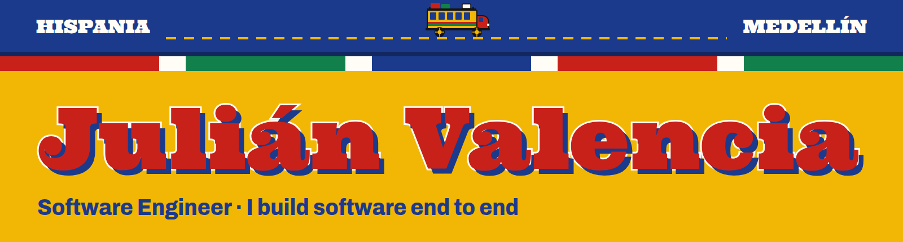

 

  

 

 
  

    "I'm a Computer Scientist 🎓 from EAFIT University 🏛. I'm a passionate learner who's always willing to learn and work across technologies and fields 💡. I love to         explore new technologies and harness them to solve real-life problems ✨. I'm deeply involved in Web  Development, machine learning, and application architecture 🕸️."

  <h2 align="center">Technology Stack 🧰 </h2>
  
  
  
  
  
  
  
  
  
  
  
  
  
  
  
  
  
  
  
  
  
  
  
  
  

 

  <h2 align="center">Reach me out on 📫</h2>
 
 
 

  

 
  <h2 align="center">Random Dev Quote ✍️</h2>
  

  

  <h1>Take a look at my repositories 👇</h1>

